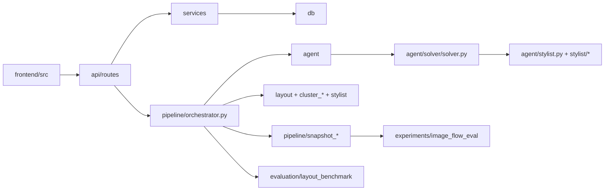

# TKNT Code Understanding Ledger

Purpose: track how far each part of the project has been read, understood,
cleaned, and verified. This file is intentionally practical: use it as the
single place to mark progress while cleaning the project file by file.

Last mapped: 2026-06-10.

## How To Use

Status legend:

| Status | Meaning |
| --- | --- |
| `Mapped` | File or area has been located and its role is known. |
| `First pass` | Read enough to understand the main behavior and dependencies. |
| `Deep read` | Read line by line and can explain every branch/data shape. |
| `Cleaned` | Refactored or formatted according to repo rules. |
| `Verified` | Covered by focused test, lint, type check, build, or manual run. |

Recommended daily loop:

1. Pick one file from the current priority group.
2. Read imports, public types, public functions/classes, then private helpers.
3. Write a one-line summary in the `Notes` column.
4. Clean only that file or one tightly related cluster.
5. Run the smallest useful verification.
6. Move the status forward.

Do not try to clean generated output, cached models, local environments, or
vendored third-party code line by line.

## Project Shape



## What Counts As Source

Mapped source areas:

| Area | Files | Lines | Role |
| --- | ---: | ---: | --- |
| `agent` | 8 | 20,456 | LLM/deterministic planning agents and solver entrypoints. |
| `pipeline` | 11 | 17,036 | Orchestration, variants, snapshots, ablations, account autosave. |
| `frontend/src` | 30 | 24,863 | React editor, 2D/3D UI, API client, state store. |
| `test_agent` | 34 | 15,741 | Backend architecture/unit/regression tests. |
| `experiments/image_flow_eval` | 19 | 15,853 | Image flow experiment harness and tests. |
| `scripts` | 15 | 10,690 | Inventory/database/manual calibration utilities. |
| `evaluation/layout_benchmark` | 13 | 7,114 | Benchmark runner, normalization, scoring, visualization. |
| `object_program` | 2 | 1,128 | Solver-ready object program builder. |
| `verifier` | 7 | 4,583 | Spatial scorer/export CLIs. |
| `stylist` | 5 | 3,977 | Deterministic layout, style policy, rule loaders, and room essentials data. |
| `synthetic_data` | 4 | 3,420 | Demo inventory/data generation. |
| `layout` | 12 | 3,366 | Room profiles, orientation, semantic roles, grid policy. |
| `db` | 10 | 2,071 | Domain models, Postgres persistence, runtime schema, and bootstrap data. |
| `tier_count` | 1 | 2,425 | Tier counting helper logic. |
| `api` | 8 | 2,218 | FastAPI app and routes. |
| `prompt` | 9 | 1,989 | Prompt text and system instructions. |
| `agent_schema` | 4 | 667 | Pydantic schema contracts for agent outputs. |
| `services` | 3 | 761 | Auth and user-content business services. |
| `config` | 6 | 435 | Runtime config and LLM config loaders. |
| `clients` | 4 | 408 | LLM client protocols and OpenAI implementation. |
| `query` | 2 | 207 | User input query helpers. |
| Root entrypoints/config | 13 | 3,043 | CLI entrypoints, app config, compose/setup files, sample input. |
| Extra experiment scripts | 15 | 8,464 | Image-flow preparation scripts, HF image edit lab, GLB/Hunyuan helpers. |

Artifact/vendor/external areas:

| Path | Treatment |
| --- | --- |
| `.cache/`, `.conda_envs/`, `.conda_pkgs/`, `.ruff_cache/`, `__pycache__/` | Local cache/env. Ignore and do not commit. |
| `.playwright-mcp/` | Browser automation logs/snapshots. Ignore. |
| `cases/`, `clients/demo_user_*`, `tmp/`, `outputs*/`, `logs/` | Runtime output/regression artifacts. Keep only curated fixtures if needed. |
| `experiments/image_flow_eval/runs/`, `experiments/image_flow_eval/layout_artifacts*/`, `experiments/image_flow_eval/cases*/` | Experiment data/artifacts. Do not line-review as source. |
| `generated/user_content/`, `generated/object_3d_jobs/` | User/render output. Ignore. |
| `frontend/node_modules/`, `frontend/dist/` | Dependency/build output. Ignore. |
| `frontend/src/vendor/three/`, `frontend/public/assets/three/`, `assets/three/` | Vendored Three.js. Do not rewrite unless upgrading vendor package. |
| `other_systems/`, `openshape-demo-support/` | External comparison/support repos. Treat as third-party/reference. |
| `manual_glb_orientation_bundle/` | Manual duplicate/reference bundle. Review source copy only if this bundle must be shipped. |
| `OpenShape-Embeddings/` | Model embedding support/cache. Treat as model artifact/support, not app source. |
| `Thesis_Chapters_DOCX/`, `Thesis_LaTeX/`, `out/Thesis_Chapters_DOCX/` | Thesis artifacts. Keep outside normal code clean pass. |
| `models/metrics/*.pt`, `*.pth`, `*.safetensors`, GLB outputs | Large binary/model artifacts. Ignore or Git LFS, not normal Git. |

## Critical Reading Order

1. Backend boot and API boundary:
   `api/main.py`, `api/routes/pipeline.py`, `api/routes/auth.py`,
   `api/routes/account.py`, `api/routes/inventory.py`.
2. Runtime config and persistence:
   `config/*`, `db/models.py`, `db/pg_*.py`,
   `services/*`.
3. Pipeline happy path:
   `pipeline/orchestrator.py`, `pipeline/manual_placements.py`,
   `pipeline/layout_variants.py`, `pipeline/dropped_inventory.py`.
4. Agent stages:
   `agent/room_interpreter.py`, `agent/seed_relation_planner.py`,
   `agent/tier_count_director.py`, `agent/seed_concept_generator.py`,
   `agent/solver/solver.py`, `agent/stylist.py`.
5. Domain helpers:
   `layout/*`, `object_program/*`, `stylist/*`.
6. Frontend state and API:
   `frontend/src/types.ts`, `frontend/src/api.ts`, `frontend/src/store.ts`,
   `frontend/src/App.tsx`.
7. Frontend editing/rendering:
   `Canvas2D.tsx`, `ThreeDPreviewPanel.tsx`, `Toolbar.tsx`, utility files.
8. Evaluation:
   `evaluation/layout_benchmark/*`, `experiments/image_flow_eval/*`.
9. Scripts and synthetic data:
   `scripts/*`, `synthetic_data/*`, `verifier/*`.
10. Tests:
   Start from architecture tests that match the file being cleaned.

## Current First-Pass Notes

| Area | Status | Notes |
| --- | --- | --- |
| Backend app | `First pass` | FastAPI app includes auth/account/inventory/pipeline routers, mounts generated assets, initializes schema/shared inventory, logs LLM profile. |
| Pipeline orchestrator | `First pass` | Main run writes ordered artifacts from room interpreter through seed relation planner, tier count, seed concepts, solver, stylist, and layout variants. Artifact/status IO and request non-functional refill now live in split helper modules. |
| Room interpreter | `First pass` | Mostly deterministic geometry/topology interpretation; produces room output without relying on LLM in current path. |
| Seed relation planner | `First pass` | Uses semantic layout planner/profile rules when enabled; has LLM JSON fallback/repair path. |
| Tier count | `First pass` | Current path is deterministic; uses request contract, room profile capacity, aliases, exclusive families. |
| Seed concept generator | `First pass` | Creates macro programs/regions/candidates; orchestrator currently calls bundle generation with LLM off. |
| Solver | `Mapped` | Huge CP-SAT/finite-pose solver. Needs staged deep read by candidate generation, constraints, scoring, output shaping. |
| Stylist | `Cleaned` | Applies style policy and deterministic payloads; validates with schema. Legacy tool-call runner has been removed from the agent file. |
| API pipeline routes | `Cleaned` | `api/routes/pipeline.py` owns run/status/result/artifact; `api/routes/snapshot_images.py` owns snapshot render/edit/preset endpoints under the same `/pipeline` prefix. |
| Auth/user services | `First pass` | PBKDF2/session-token auth, user asset/render/layout persistence via DB repositories and generated content files. |
| Frontend app/store/API | `Cleaned` | Zustand state owns floorplan/design/auth/renders/snapshots/billing; API client maps FastAPI routes; App coordinates startup/bootstrap; frontend inventory tenant is now fixed to shared `demo_tenant`. |
| Frontend 3D panel | `Mapped` | Very large Three.js/editor/render surface. Split into snapshot, camera, object controls, render/edit, saved render pieces before deeper cleanup. |
| Benchmarks/eval | `First pass` | Layout benchmark and image-flow lab are useful for verification but contain many generated data directories. |
| Tooling | `Mapped` | `requirements.txt` exists; no `pyproject.toml` or `pyrightconfig.json` found in first pass. Add repo-level Ruff/type config later to match AGENTS rules. |

## High-Risk Cleanup Targets

| File | Why risky | Suggested cleanup unit |
| --- | --- | --- |
| `agent/solver/solver.py` | 8.7k lines, object-level anchor/support placement and scoring. | Macro CP-SAT path removed; split object geometry/scoring only after object-level tests stay green. |
| `pipeline/orchestrator.py` | 4k lines, central integration path. | Artifact/status and request non-functional refill are split; continue by extracting stage runners or gallery assembly one unit at a time. |
| `frontend/src/components/ThreeDPreviewPanel.tsx` | 7.8k lines, UI + Three scene + render workflows. | Extract camera/snapshot/render/edit/object panels with build checks after each step. |
| `agent/tier_count_director.py` | 6.1k lines, deterministic counting policy. | Extract aliases/family rules/profile capacity adapters. |
| `agent/seed_concept_generator.py` | 5.3k lines, macro concept generation. | Extract region construction, validation, and instantiation. |
| `pipeline/snapshot_image_renderer.py` | 4.6k lines, OpenAI image adapter and prompt policy. | Preserve create/edit flow variants; remove only orphan prompt/request helpers with renderer tests. |
| `experiments/image_flow_eval/image_flow_eval/metrics.py` | 3.6k lines, metric dependencies and model loading. | Isolate heavyweight model adapters from pure metric aggregation. |
| `frontend/src/store.ts` | 1k lines, central mutable UI state. | Clean carefully with TypeScript build after each mutation group. |
| `api/routes/snapshot_images.py` | 1k lines, snapshot render/edit routes and image-flow request helpers. | Preserve create/edit flow variants; future cleanup should split pure request builders from FastAPI route handlers. |

## File Ledger

### Root Entrypoints And Repo Config

| File | Status | Purpose | Notes |
| --- | --- | --- | --- |
| `app-config-template.yaml` | `Mapped` | Shared app config template. | Check that secrets/defaults are safe. |
| `app-config.docker.yaml` | `Mapped` | Docker-oriented app config. | Keep in sync with compose/env docs. |
| `app-config.yaml` | `Mapped` | Local/default app config. | Review before committing if machine-specific. |
| `docker-compose.yml` | `Cleaned` | Local service orchestration. | Removed dead Elasticsearch/embed/Gemini/seed-guided env wiring; pair with DB/OpenAI config review. |
| `ghesofa.glb.orientation.json` | `Mapped` | GLB orientation metadata. | Asset metadata, not code. |
| `manual_local_glb_orientation.py` | `Mapped` | Manual local GLB orientation utility. | Large root script; consider moving under `scripts/`. |
| `render_round_3d.py` | `Mapped` | 3D render helper/entrypoint. | Clarify whether used by app or legacy workflow. |
| `requirements.txt` | `Cleaned` | Python runtime dependencies. | Removed legacy encrypted-key dependency and duplicate `beautifulsoup4`; no Ruff/type config found yet. |
| `run_case_backend_cli.py` | `First pass` | CLI wrapper around `pipeline.orchestrator.run_case`. | Useful smoke-test entrypoint. |
| `sample_input.json` | `Mapped` | Sample backend input payload. | Fixture/data, not code. |
| `setup_env.sh` | `Cleaned` | Conda setup helper. | Removed legacy encrypted-key dependency from local setup. |
| `test_stylist.py` | `Mapped` | Root stylist test/script. | Consider moving into `test_agent/`. |
| `vis.py` | `Mapped` | Visualization helper. | Clarify if still active. |

### API

| File | Status | Purpose | Notes |
| --- | --- | --- | --- |
| `api/__init__.py` | `Mapped` | Package marker. |  |
| `api/deps.py` | `First pass` | FastAPI auth dependencies. | Keeps query-token support because frontend appends `access_token` to protected file/model URLs that cannot send Authorization headers. |
| `api/main.py` | `Cleaned` | App boot, router registration, startup init. | Simplified runtime profile logging, registered the split snapshot image router, updated shared-inventory startup wording, and removed silent schema-init skip so DB-backed shared inventory failures surface clearly. |
| `api/routes/__init__.py` | `Cleaned` | Route package exports. | Exports the split `snapshot_images` router module alongside core pipeline/auth/account/inventory routes. |
| `api/routes/account.py` | `Cleaned` | User account/layout/render endpoints. | Generated render file responses now use DB `image_bytes` only; frontend uses saved layout/render CRUD and render metadata/file endpoints; missing render payloads now return a specific 404 path. |
| `api/routes/auth.py` | `Cleaned` | Login/register/session endpoints. | Removed redundant email casts, removed public account `tenant_id`, and made logout convert late session revoke/auth failures to 401 instead of an uncaught error. |
| `api/routes/inventory.py` | `Cleaned` | Shared inventory list/file endpoints. | Removed unused `/types`, `/search`, owned asset file access, the legacy `demo_inventory_test` gate, and runtime JSON fallback; `/items` always loads `TKNT_SHARED_INVENTORY_TENANT_ID` through the shared inventory repository. |
| `api/routes/pipeline.py` | `Cleaned` | Pipeline run/status/result/artifact routes. | Split snapshot image routes into `api/routes/snapshot_images.py`; removed the unused prompt-compile debug route and legacy `cluster_forge` artifact alias; kept account autosave and narrowed non-boundary fallback exception handling. |
| `api/routes/snapshot_images.py` | `Cleaned` | Snapshot image render/edit stream and preset route handlers. | New split from `api/routes/pipeline.py`; preserves `/pipeline/render-snapshot-image`, stream, and preset URLs while delegating request-building/render helpers to `api/routes/snapshot_image_support.py`. |
| `api/routes/snapshot_image_support.py` | `Cleaned` | Snapshot image request/response models, flow config, preflight/mask handling, render execution, saved-render persistence helpers. | Split from route handlers without changing create/edit flow variants, layout reference pass-through, or saved-render behavior. |

### Config And Clients

| File | Status | Purpose | Notes |
| --- | --- | --- | --- |
| `clients/__init__.py` | `Mapped` | Package marker. |  |
| `clients/base_client.py` | `First pass` | LLM protocol and usage dataclasses. |  |
| `clients/llm_client.py` | `Cleaned` | Resolves configured LLM client. | Removed the dead provider branch; current runtime has a single OpenAI client path. |
| `clients/openai_client.py` | `Verified` | OpenAI/Azure chat, embedding, usage tracking. | Removed stale base-url branch comment and verified JSON schema/max-token behavior plus current agent callers. |
| `config/__init__.py` | `Cleaned` | Root YAML/env config loader. | Removed duplicate success log, fixed traceback-preserving raise, and made config file reads explicit UTF-8. |
| `config/llm_config.py` | `Cleaned` | LLM config helpers. | Removed dead provider abstraction and empty default model-chain path while preserving benchmark/single-model overrides. |
| `config/logging_config.py` | `Cleaned` | Logging setup. | Removed unused named log files for deleted/unused logger channels; kept root logging and the live `image_flow` JSONL logger. |
| `config/models.py` | `Cleaned` | Pydantic config models. | Removed legacy model aliases and encrypted-key config fields; current OpenAI config requires direct `api_key`. |
| `config/openai_config.py` | `Verified` | OpenAI config loader. | Removed encrypted-key fallback and direct `Fernet` dependency; current path reads `services.openai.api_key` plus benchmark model overrides. |
| `config/settings.py` | `Cleaned` | Env dataclass settings. | Kept only Postgres and vector dimension settings with defaults aligned to `.env.example`/Docker; removed unused Elasticsearch/OpenAI/embed/batch fields. |

### Database And Services

| File | Status | Purpose | Notes |
| --- | --- | --- | --- |
| `db/__init__.py` | `Cleaned` | Public DB exports. | Removed exports for deleted compatibility/in-memory repository modules, unused schema notes, and internal Postgres config loader; public Postgres repos now import from concrete modules. |
| `db/shared_inventory_bootstrap.py` | `Cleaned` | Shared inventory bootstrap helpers. | Renamed from demo data, removed the runtime enable/disable env branch, and kept automatic bootstrap into `TKNT_SHARED_INVENTORY_TENANT_ID`. |
| `db/models.py` | `Cleaned` | Domain models and typed IDs. | No user-owned asset model remains; generated renders no longer expose local `storage_path`; render source is narrowed to snapshot renders only. |
| `db/pg_assets.py` | `Cleaned` | Postgres shared inventory asset repository. | Removed unused standalone create/update/search and asset-file write methods; kept asset upsert, asset/file reads, and embedding backfill methods used by inventory loading, GLB maintenance scripts, and runtime shared inventory. |
| `db/pg_knowledge.py` | `Cleaned` | Postgres design knowledge repository. | Removed unused create/update/vector-search/list-embedding methods; kept upsert/get/list and embedding backfill methods used by size rules, room essentials, tier-count profile loading, and synthetic data load scripts. |
| `db/pg_user_content.py` | `Cleaned` | Saved layouts/renders/auth persistence. | Repository now covers accounts, sessions, saved layout cases/options, and DB-backed snapshot render bytes only. |
| `db/pg_utils.py` | `Mapped` | Postgres conversion helpers. |  |
| `db/postgres.py` | `Cleaned` | DB connection management. | Internalized the settings-to-PostgresConfig loader; public surface keeps only `PostgresConfig` and `create_connection`. |
| `db/runtime_init.py` | `Cleaned` | Runtime DB/schema init. | Removed legacy generated-render file-to-DB migration; runtime init now only applies schema, checks required tables, and catches DB schema statement failures specifically. |
| `db/schema.py` | `Cleaned` | Schema creation/migration SQL. | Removed legacy `*_cm` asset-dimension migration, local render `storage_path`, and unused schema notes helper; shared inventory tenant fallback is normalized for asset migrations. |
| `services/__init__.py` | `Mapped` | Package marker. |  |
| `services/auth_service.py` | `Cleaned` | Password/session auth service. | Shared inventory tenant now normalizes empty env values back to `demo_tenant`; internal account scope ids remain only for DB compatibility, not inventory ownership. |
| `services/user_content_service.py` | `Cleaned` | Shared inventory, layouts, renders service. | Removed unused generated-asset save path, owned asset listing/access, and render-from-file fallback; shared inventory listing/file access now resolves only `TKNT_SHARED_INVENTORY_TENANT_ID`; kept saved layout and DB-backed generated-render paths. |

### Pipeline

| File | Status | Purpose | Notes |
| --- | --- | --- | --- |
| `pipeline/ablation_modes.py` | `Cleaned` | Ablation mode definitions/transforms. | Kept all experiment branches; derived valid mode set from the system-id registry to avoid duplicate mode lists. |
| `pipeline/account_layout_autosave.py` | `Cleaned` | Autosave completed pipeline cases. | Removed legacy stylist/absolute-layout fallback; runtime now saves completed options from layout variants only. |
| `pipeline/dropped_inventory.py` | `Cleaned` | Solver drop summary and controlled accessory refill. | Removed legacy collect/merge/reintroduce helpers; kept runtime payload and ablation-aware controlled refill path. |
| `pipeline/image_flow_edit_masks.py` | `Deep read` | Image edit mask helpers. | No safe branch deletion found; formatted only, preserving add/replace object-scope mask behavior and stable-camera edit bypass metadata. |
| `pipeline/image_flow_logging.py` | `Deep read` | Image flow logging helpers. | No safe deletion found; public logging/redaction helpers are used by API routes and snapshot renderer. |
| `pipeline/image_flow_preflight.py` | `Cleaned` | Render/edit preflight checks. | Production module now types only the supported edit-object-scope profile; experiment preflight variants remain in the experiment package. |
| `pipeline/layout_variants.py` | `Cleaned` | Final gallery selection and summary helpers. | Removed legacy artifact/top-candidate compatibility wrappers; runtime keeps distinct gallery selection, macro signature, and summary paths. |
| `pipeline/manual_placements.py` | `Cleaned` | Manual placement contract handling. | Removed unused layout-variants artifact wrapper; kept orchestrator entrypoints for prepare/guidance/cluster/tier/layout/styled merges. |
| `pipeline/orchestrator.py` | `First pass` | End-to-end case pipeline. | Split artifact/status IO and request non-functional refill helpers; still highest integration risk, so continue by stage. |
| `pipeline/orchestrator_artifacts.py` | `Cleaned` | Case path registry, module manifest, JSON artifact writer, downstream stale markers, and status writer. | Extracted from orchestrator without changing artifact names or status payload shape. |
| `pipeline/request_non_functional_refill.py` | `Cleaned` | Adds requested non-functional decor objects such as rugs, curtains, cushions, blankets, wall art, and ceiling lights after solver when contract coverage needs them. | Extracted from orchestrator; keeps profile-specific non-functional specs and place_on method validation. |
| `pipeline/snapshot_image_renderer.py` | `Cleaned` | OpenAI image generation/edit adapter. | Removed orphan supplemental-prompt/user-prompt/diagnostic helpers; preserved main render path plus create/edit flow variant contracts. |
| `pipeline/snapshot_prompt_compiler.py` | `Cleaned` | Snapshot payload to image prompt contract. | Removed unused count helper; kept minor-decor config because renderer/API tests still exercise both paths. |

### Agent Layer

| File | Status | Purpose | Notes |
| --- | --- | --- | --- |
| `agent/seed_relation_planner.py` | `First pass` | Cluster plan generation via semantic planner or LLM fallback. |  |
| `agent/request_contract.py` | `Mapped` | User request contract extraction/modeling. |  |
| `agent/request_reconciliation.py` | `Mapped` | Reconcile request contract with outputs. |  |
| `agent/room_interpreter.py` | `First pass` | Room geometry/topology interpretation. |  |
| `agent/seed_concept_generator.py` | `First pass` | Macro seed concept generation. |  |
| `agent/semantic_layout_planner.py` | `Cleaned` | Semantic layout planning. | Removed empty adaptive default model-chain config; adaptive LLM stages still use configured OpenAI model chains. |
| `agent/solver/solver.py` | `Cleaned` | Object-level anchor/support placement solver. | Macro CP-SAT entrypoints/helpers removed; main runtime keeps `generate_object_layout`. |
| `agent/stylist.py` | `Cleaned` | Style plan and styled layout output. | Removed unused tool-call runner, parser alias, stylist tool imports, old prompt builder, and inventory-size validation helpers tied only to that runner; current path keeps style-plan JSON plus deterministic payload application. |
| `agent/tier_count_director.py` | `First pass` | Object count/tier planning. | Large deterministic policy. |

### Agent Schemas And Prompts

| File | Status | Purpose | Notes |
| --- | --- | --- | --- |
| `agent_schema/clusterF_schema.py` | `Mapped` | Seed relation planner schema. |  |
| `agent_schema/roomI_schema.py` | `Mapped` | Room interpreter schema. |  |
| `agent_schema/semantic_layout_planner_schema.py` | `Mapped` | Semantic planner schema. |  |
| `agent_schema/stylist_schema.py` | `Mapped` | Stylist output schema. |  |
| `prompt/seed_relation_planner.py` | `Mapped` | Seed relation planner prompt. |  |
| `prompt/room_interpreter.py` | `Mapped` | Room interpreter prompt. |  |
| `prompt/semantic_layout_planner.py` | `Mapped` | Semantic planner prompt. |  |
| `prompt/stylist.py` | `Mapped` | Stylist prompt. |  |
| `prompt/system.py` | `Mapped` | Shared system prompt. |  |
| `prompt/tier_count.py` | `Mapped` | Tier count prompt. |  |

### Layout, Composer, Placer, Stylist Helpers

| File | Status | Purpose | Notes |
| --- | --- | --- | --- |
| `object_program/__init__.py` | `Cleaned` | Public object-program builder export. | Replaces the deleted composer package. |
| `object_program/builder.py` | `Cleaned` | Builds solver-ready object programs from seed relation and tier-count output. | Renamed main function to `build_solver_object_program`; deleted orphan cluster constraint scorer. |
| `constraint/hard_constraint.py` | `Mapped` | Hard constraints. | Empty/near-empty line count in first sweep; verify. |
| `constraint/soft_layout_rules.py` | `Mapped` | Soft layout rules. | Empty/near-empty line count in first sweep; verify. |
| `layout/grid_policy.py` | `Mapped` | Grid policy helpers. |  |
| `layout/kitchen_profile.py` | `Mapped` | Kitchen profile rules. |  |
| `layout/orientation_contract.py` | `First pass` | Cardinal orientation/rotation helpers. |  |
| `layout/orientation_metadata.py` | `First pass` | Attach orientation metadata to outputs. |  |
| `layout/room_profiles/__init__.py` | `Mapped` | Profile package marker. |  |
| `layout/room_profiles/base.py` | `Mapped` | Room profile base models. |  |
| `layout/room_profiles/kitchen.py` | `Mapped` | Kitchen profile. |  |
| `layout/room_profiles/legacy.py` | `Mapped` | Legacy profile compatibility. |  |
| `layout/room_profiles/registry.py` | `First pass` | Bedroom/living/kitchen profile registry. |  |
| `layout/semantic_roles.py` | `Mapped` | Semantic role definitions. |  |
| `layout/tools.py` | `Mapped` | Layout helper tools. |  |
| `layout/variant_family.py` | `Mapped` | Variant family helpers. |  |
| `stylist/deterministic_layout.py` | `Cleaned` | Deterministic styled layout payload and accessory inventory profile lookup. | Absorbed the only live inventory helper from deleted `stylist/tools.py`; old tool registry/schema, design-knowledge tool path, and legacy `demo_inventory_test` gate were removed; inventory fallback now uses the shared tenant helper. |
| `stylist/room_essentials_loader.py` | `Mapped` | Room essentials loading. |  |
| `stylist/room_essentials_seed.py` | `Mapped` | Room essentials seed data. |  |
| `stylist/rules.py` | `Cleaned` | Soft rule templates plus room-selection and compiled semantic-program rule loaders. | Merged deleted `room_selection_rules.py` and `semantic_program_rules.py`; shared JSON clone/cache helpers now live in one rules module. |
| `stylist/style_policy.py` | `Cleaned` | Style policy compiler, deterministic fallback, neutral ablation policy, semantic-program adapter, refill policy, and final style-plan adapter. | Removed unreachable non-strict LLM fallback inside the private LLM seed helper and the no-op retry recorder; kept main LLM path, deterministic `use_llm=False`, and `no_style_policy` ablation; LLM repair catches now target OpenAI/parse/validation errors. |
| `tier_count/tools.py` | `Cleaned` | Tier counting helper tools. | Kept size profile generation/freeze paths and runtime `get_size_profiles`; inventory fallback now uses the shared tenant helper instead of hardcoded tenant text, and parse fallbacks now catch specific errors. |

### Frontend

| File | Status | Purpose | Notes |
| --- | --- | --- | --- |
| `frontend/src/App.tsx` | `Cleaned` | App bootstrap and workspace shell. | Inventory bootstrap now calls shared inventory without passing tenant id; eval auth user no longer carries a tenant id. |
| `frontend/src/api.ts` | `Cleaned` | FastAPI client and API types. | `fetchInventory` now calls `/inventory/items` without tenant query; removed unused non-stream snapshot render client and reduced internal stream/lock types plus token-url helper to private scope. |
| `frontend/src/billing.ts` | `Cleaned` | Billing helpers. | Removed legacy localStorage image/use key aliases; current runtime keeps credit-based billing settings; reduced image-size/quality helper types and default factory to private scope. |
| `frontend/src/components/AccountPanel.tsx` | `Deep read` | Account panel UI. | No obsolete tenant/owned-asset branch found; kept saved layout case grouping, saved render filtering, and snapshot-render reopening guard. |
| `frontend/src/components/AuthScreen.tsx` | `Cleaned` | Login/register UI. | Removed custom asset wording; account scope is saved layouts/renders plus shared inventory. |
| `frontend/src/components/BillingPaymentModal.tsx` | `Deep read` | Billing payment modal. | No obsolete branch found; mock QR/payment confirmation path is still used by profile and render/edit flows. |
| `frontend/src/components/Canvas2D.tsx` | `Cleaned` | 2D floorplan editor. | Removed dead visual-relation canvas capture wiring, unreachable hover tag branch, unused store selector, and redundant rug helper; drag/drop remains shared inventory only. |
| `frontend/src/components/LayoutVariantsGallery.tsx` | `Cleaned` | Variant preview/selection UI. | Preview reads typed runtime layout payloads instead of relying on `{}` property access. |
| `frontend/src/components/LibraryPanel.tsx` | `Cleaned` | Inventory browser UI. | Removed owned/shared split; library now renders the shared inventory set only. |
| `frontend/src/components/ProfileModal.tsx` | `Cleaned` | Profile/billing/render history UI. | Removed tenant display and dev-only billing price/quota controls; user path keeps plan selection and credit purchase. |
| `frontend/src/components/ThreeDPreviewPanel.tsx` | `Cleaned` | Three.js preview, snapshot, render/edit workflows. | Removed user-generated asset preview branch tied to owned inventory; fixed runtime type aliases for placements/openings/walls; broader file still large and high-risk. |
| `frontend/src/components/Toolbar.tsx` | `Cleaned` | Pipeline run/polling/status toolbar. | Removed visual-relation experimental request wiring, dead `additionRequests` reset, local tenant state usage, legacy `cluster_forge` progress alias, and untyped env access. |
| `frontend/src/components/UserInputPanel.tsx` | `Cleaned` | User prompt/input panel. | Removed redundant room/style normalization effect because store-level updates already normalize input. |
| `frontend/src/evalHooks.ts` | `Cleaned` | Evaluation hooks. | Kept image-flow eval bridge gate; removed non-exposed `TKNT_ENABLE_EVAL_HOOKS` branch and `any` env access. |
| `frontend/src/main.tsx` | `Cleaned` | React entrypoint. | Removed dev-only console forwarding to missing `/__dev_log`; entrypoint now only boots React. |
| `frontend/src/options.ts` | `Cleaned` | UI/options constants. | No unused runtime option/helper found; room/style constants are shared by toolbar, prompt panel, and inventory filters; internal option types/default style are private. |
| `frontend/src/store.ts` | `Cleaned` | Zustand editor state/actions. | Removed env-driven demo inventory tenant branch, unused `setTenantId`, visual-relation capture state, orphan cluster/template/snapshot/3D-open state, and unused `setUserInput`/`setRunLogs`/`setBillingSettings` actions. |
| `frontend/src/styles.css` | `Cleaned` | Frontend stylesheet. | Removed stale cluster/log/validation/debug panel styles, old reference/edit-reference controls, duplicate library styles, and owned-asset/billing-dev CSS; selector detector and Vite build pass. |
| `frontend/src/three/inventoryDiagnostics.ts` | `Cleaned` | Inventory model diagnostics. | Removed user-generated preview detection because owned/generated inventory assets are no longer runtime path. |
| `frontend/src/three/models.ts` | `Cleaned` | GLB descriptor/model resolution. | Tightened nullable metadata typing for file-list model resolution; reduced preview calibration/override/anchor helper types to private scope. |
| `frontend/src/three/proxies.ts` | `Cleaned` | Three proxy objects/assets. | Kept procedural fallback builders because categories are dispatched dynamically; primitive helpers all have callers, and `ProxyBuildParams` is private. |
| `frontend/src/three/thumbnails.ts` | `Deep read` | Thumbnail helpers. | Both public helpers are used by LibraryPanel; no obsolete owned-asset branch found, kept shared inventory GLB thumbnail rendering. |
| `frontend/src/types.ts` | `Cleaned` | Core frontend domain types. | Added runtime aliases for room polygons, placement ids, openings, and layout result payloads; removed unused template item, cluster preview fields, and public auth-user tenant id. |
| `frontend/src/vite-env.d.ts` | `Cleaned` | Vite import-meta env typing. | Keeps only frontend-exposed `VITE_*` env keys used by the app. |
| `frontend/src/utils/annotatedPerspectiveReference.ts` | `Cleaned` | Annotated perspective reference image helpers. | Removed unused legacy annotation-overlay builder; kept structural perspective and edge-map helpers used by image render flow. |
| `frontend/src/utils/geometry.ts` | `Deep read` | Frontend geometry helpers. | All exports have callers: canvas coordinate/bounds/clamp, store and pipeline normalization, and 3D preview bounds. |
| `frontend/src/utils/pipelineLayouts.ts` | `Cleaned` | Backend pipeline output to UI layout transform. | Removed dead `cluster_previews` variant payload generation; main layout/variant import path remains. |
| `frontend/src/utils/planOrientation.ts` | `Cleaned` | Plan orientation helpers. | Removed unused cardinal-rotation helper; remaining exports are used by store, canvas, pipeline layout import, and 3D preview. |
| `frontend/src/utils/styledLayout.ts` | `Cleaned` | Styled layout utilities. | Reduced bbox-from-points helper to private scope; exported helpers all have callers. |
| `frontend/src/utils/threeSnapshot.ts` | `Cleaned` | 3D snapshot payload/visibility/occlusion helpers. | Kept artifact/visibility path used by image generation/edit flows; reduced internal geometry helper types to private scope. |

### Evaluation And Experiments

| File | Status | Purpose | Notes |
| --- | --- | --- | --- |
| `evaluation/layout_benchmark/README.md` | `First pass` | Benchmark instructions. |  |
| `evaluation/layout_benchmark/__init__.py` | `Mapped` | Package marker. |  |
| `evaluation/layout_benchmark/analyze_stability_holdout.py` | `Mapped` | Stability analysis. |  |
| `evaluation/layout_benchmark/backfill_normalized_orientations.py` | `Mapped` | Orientation backfill utility. |  |
| `evaluation/layout_benchmark/cache_env.py` | `Mapped` | Benchmark cache environment helpers. |  |
| `evaluation/layout_benchmark/external_runners.py` | `Mapped` | IDesign/FlairGPT runner adapters. |  |
| `evaluation/layout_benchmark/normalize.py` | `Mapped` | Normalize benchmark outputs. |  |
| `evaluation/layout_benchmark/requirements/README.md` | `Mapped` | Benchmark dependency notes. |  |
| `evaluation/layout_benchmark/run_ablation_all.sh` | `Cleaned` | Ablation benchmark convenience runner. | Removed pass-through for deleted demo-inventory flags; benchmark model/fallback controls remain. |
| `evaluation/layout_benchmark/run_benchmark.py` | `First pass` | Benchmark plan/run/resume/score CLI. |  |
| `evaluation/layout_benchmark/schema.py` | `First pass` | Normalized benchmark dataclasses. |  |
| `evaluation/layout_benchmark/scoring.py` | `First pass` | Geometry/request/count scoring. |  |
| `evaluation/layout_benchmark/visualize_runs.py` | `Mapped` | Benchmark visualization. |  |
| `experiments/hf_image_edit_macos_lab/README.md` | `Mapped` | HF image edit lab instructions. | Lab/reference workflow. |
| `experiments/hf_image_edit_macos_lab/common.py` | `Mapped` | HF lab shared helpers. |  |
| `experiments/hf_image_edit_macos_lab/environment-macos.yml` | `Mapped` | HF lab Conda environment. | Keep out of app runtime. |
| `experiments/hf_image_edit_macos_lab/run_flux1_schnell.py` | `Mapped` | HF Flux 1 lab runner. |  |
| `experiments/hf_image_edit_macos_lab/run_flux2_klein_base_4b.py` | `Mapped` | HF Flux 2 lab runner. |  |
| `experiments/hf_image_edit_macos_lab/run_instruct_pix2pix.py` | `Mapped` | HF InstructPix2Pix lab runner. |  |
| `experiments/image_flow_eval/README.md` | `First pass` | Image-flow experiment instructions. |  |
| `experiments/image_flow_eval/annotate_edit_bboxes.py` | `Mapped` | Edit bbox annotation helper. | Large experiment script. |
| `experiments/image_flow_eval/build_curated_create_manifests.py` | `Mapped` | Curated create manifest builder. |  |
| `experiments/image_flow_eval/build_stabilization_manifest.py` | `Mapped` | Stabilization manifest builder. |  |
| `experiments/image_flow_eval/image_flow_eval/__init__.py` | `Mapped` | Package marker. |  |
| `experiments/image_flow_eval/image_flow_eval/ablations.py` | `First pass` | Image-flow ablation transforms. |  |
| `experiments/image_flow_eval/image_flow_eval/cli.py` | `First pass` | Experiment CLI. |  |
| `experiments/image_flow_eval/image_flow_eval/io.py` | `First pass` | Manifest/result IO. |  |
| `experiments/image_flow_eval/image_flow_eval/metrics.py` | `First pass` | Image/depth/DINO/LLM metrics. | Heavy model adapter risk. |
| `experiments/image_flow_eval/image_flow_eval/preflight.py` | `First pass` | Preflight validation. |  |
| `experiments/image_flow_eval/image_flow_eval/providers.py` | `First pass` | Provider bridge to TKNT renderer. |  |
| `experiments/image_flow_eval/image_flow_eval/semantic_repair.py` | `First pass` | Semantic repair helpers. |  |
| `experiments/image_flow_eval/image_flow_eval/types.py` | `First pass` | Experiment dataclasses/types. |  |
| `experiments/image_flow_eval/prepare_layout_snapshots.py` | `Mapped` | Snapshot preparation helper. | Large experiment script. |
| `experiments/image_flow_eval/score_edit_variants.py` | `Mapped` | Edit variant scoring helper. |  |
| `experiments/image_flow_eval/select_edit_source_variants.py` | `Mapped` | Edit source selection helper. |  |
| `experiments/image_flow_eval/tests/test_annotate_edit_bboxes.py` | `Mapped` | Experiment test. |  |
| `experiments/image_flow_eval/tests/test_curated_create_manifests.py` | `Mapped` | Experiment test. |  |
| `experiments/image_flow_eval/tests/test_metrics.py` | `Mapped` | Experiment test. |  |
| `experiments/image_flow_eval/tests/test_preflight.py` | `Mapped` | Experiment test. |  |
| `experiments/image_flow_eval/tests/test_prepare_layout_snapshots.py` | `Mapped` | Experiment test. |  |
| `experiments/image_flow_eval/tests/test_resume.py` | `Mapped` | Experiment test. |  |
| `experiments/image_flow_eval/tests/test_select_edit_source_variants.py` | `Mapped` | Experiment test. |  |
| `experiments/image_flow_eval/tests/test_semantic_repair.py` | `Mapped` | Experiment test. |  |
| `experiments/image_flow_eval/tests/test_stabilization_manifest.py` | `Mapped` | Experiment test. |  |
| `experiments/image_flow_eval/tests/test_strict_layout.py` | `Mapped` | Experiment test. |  |
| `experiments/test_hunyuan3d_chair.py` | `Mapped` | Hunyuan3D chair test/helper. | Lab/reference workflow. |
| `experiments/view_glb.py` | `Mapped` | GLB viewer helper. | Lab/reference workflow. |

### Scripts, Synthetic Data, Query, Verifier

| File | Status | Purpose | Notes |
| --- | --- | --- | --- |
| `query/__init__.py` | `Mapped` | Package marker. |  |
| `query/user_input.py` | `Mapped` | User input helpers. |  |
| `scripts/apply_inventory_glb_panel_review_pass.py` | `Mapped` | Inventory GLB review application. |  |
| `scripts/backfill_embeddings.py` | `Mapped` | Embedding backfill. |  |
| `scripts/calibrate_inventory_glb.py` | `Mapped` | GLB calibration. |  |
| `scripts/check_db.py` | `Mapped` | DB check CLI. |  |
| `scripts/freeze_size_rules.py` | `Mapped` | Size rule freezer. |  |
| `scripts/inspect_inventory_glb_orientation.py` | `Mapped` | GLB orientation inspection. |  |
| `scripts/load_room_essentials.py` | `Mapped` | Room essentials loader. |  |
| `scripts/manual_bad_glb_asset_pruner.py` | `Mapped` | Manual GLB asset prune utility. |  |
| `scripts/manual_inventory_glb_orientation.py` | `Mapped` | Manual GLB orientation workflow. | Large script. |
| `scripts/normalize_inventory_glb.py` | `Mapped` | Normalize GLB metadata. |  |
| `scripts/preload_inventory_glb.py` | `Mapped` | Preload inventory GLBs. |  |
| `scripts/prune_assets_without_glb.py` | `Mapped` | DB asset pruning. |  |
| `scripts/review_inventory_glb_calibration.py` | `Mapped` | Calibration review helper. |  |
| `scripts/set_inventory_glb_preview_override.py` | `Mapped` | Preview override setter. |  |
| `scripts/show_inventory_glb_db_state.py` | `Mapped` | DB state report. |  |
| `synthetic_data/load_to_db.py` | `Mapped` | Load synthetic data to DB. |  |
| `synthetic_data/samples_gen.py` | `Mapped` | Synthetic sample generation. |  |
| `synthetic_data/size_rules.py` | `Mapped` | Size rule data/helpers. |  |
| `synthetic_data/storage_gen.py` | `Mapped` | Synthetic storage generation. |  |
| `verifier/__init__.py` | `Mapped` | Package marker. |  |
| `verifier/bedroom_spatial_scorer.py` | `Mapped` | Bedroom spatial scoring. |  |
| `verifier/export_bedroom_idesign_csv.py` | `Mapped` | Bedroom IDesign CSV export. |  |
| `verifier/export_livingroom_idesign_csv.py` | `Mapped` | Living room IDesign CSV export. |  |
| `verifier/living_room_spatial_scorer.py` | `Mapped` | Living room spatial scoring. |  |
| `verifier/score_bedroom_spatial_cli.py` | `Mapped` | Bedroom score CLI. |  |
| `verifier/score_living_room_spatial_cli.py` | `Mapped` | Living room score CLI. |  |

### Tests

| File | Status | Purpose | Notes |
| --- | --- | --- | --- |
| `test_agent/ablation_modes_test.py` | `Mapped` | Ablation mode tests. |  |
| `test_agent/seed_relation_planner_architecture_test.py` | `Mapped` | Seed relation planner architecture tests. |  |
| `test_agent/seed_relation_planner_test.py` | `Mapped` | Seed relation planner behavior tests. |  |
| `test_agent/cluster_merge_architecture_test.py` | `Mapped` | Cluster merge architecture tests. |  |
| `test_agent/dropped_inventory_architecture_test.py` | `Cleaned` | Dropped inventory architecture tests. | Covers current controlled accessory refill surface. |
| `test_agent/kitchen_profile_architecture_test.py` | `Mapped` | Kitchen profile architecture tests. |  |
| `test_agent/layout_benchmark_cache_env_test.py` | `Mapped` | Benchmark cache tests. |  |
| `test_agent/layout_benchmark_resume_test.py` | `Mapped` | Benchmark resume tests. |  |
| `test_agent/layout_benchmark_scoring_test.py` | `Mapped` | Benchmark scoring tests. |  |
| `test_agent/layout_variants_architecture_test.py` | `Mapped` | Layout variants architecture tests. |  |
| `test_agent/layout_variants_selector_test.py` | `Mapped` | Variant selector tests. |  |
| `test_agent/manual_placements_test.py` | `Cleaned` | Manual placement tests. | Covers current orchestrator-facing manual placement surface. |
| `test_agent/merge_test.py` | `Mapped` | Merge tests. |  |
| `test_agent/object_level_solver_orientation_test.py` | `Mapped` | Solver orientation tests. | Important before solver cleanup. |
| `test_agent/openai_client_architecture_test.py` | `Mapped` | OpenAI client architecture tests. |  |
| `test_agent/orchestrator_architecture_test.py` | `Mapped` | Orchestrator architecture tests. | Important before pipeline cleanup. |
| `test_agent/orientation_contract_test.py` | `Mapped` | Orientation contract tests. |  |
| `test_agent/orientation_metadata_test.py` | `Mapped` | Orientation metadata tests. |  |
| `test_agent/render_layout.py` | `Mapped` | Render layout helper/test script. |  |
| `test_agent/request_contract_test.py` | `Mapped` | Request contract tests. |  |
| `test_agent/room_interpreter_architecture_test.py` | `Mapped` | Room interpreter architecture tests. |  |
| `test_agent/room_interpreter_test.py` | `Mapped` | Room interpreter behavior tests. |  |
| `test_agent/room_profile_registry_test.py` | `Mapped` | Room profile registry tests. |  |
| `test_agent/seed_concept_generator_architecture_test.py` | `Mapped` | Seed concept architecture tests. |  |
| `test_agent/semantic_layout_planner_architecture_test.py` | `Mapped` | Semantic planner architecture tests. |  |
| `test_agent/snapshot_image_renderer_architecture_test.py` | `Cleaned` | Snapshot renderer architecture tests. | Updated assertions to match current simple-prompt variant config and camera-transfer structural guide wording. |
| `test_agent/snapshot_prompt_compiler_architecture_test.py` | `Cleaned` | Snapshot prompt compiler tests. | Updated TV-console assertions to the current integrated-screen render identity label. |
| `test_agent/solver_architecture_test.py` | `Cleaned` | Solver architecture tests. | Covers current object-level solver surface after macro path removal. |
| `test_agent/style_policy_architecture_test.py` | `Mapped` | Style policy tests. |  |
| `test_agent/stylist_architecture_test.py` | `Mapped` | Stylist architecture tests. | Important before stylist cleanup. |
| `test_agent/stylist_pipeline_test.py` | `Mapped` | Stylist pipeline tests. |  |
| `test_agent/tier_count_director_architecture_test.py` | `Mapped` | Tier count architecture tests. |  |
| `test_agent/tier_count_director_test.py` | `Mapped` | Tier count behavior tests. |  |
| `test_agent/user_content_layout_cases_test.py` | `Cleaned` | User content/layout case tests. | Covers layout case autosave/render context and shared-inventory-only asset access. |

## Verification Commands

Use these after cleaning related files:

```bash
python -m pytest test_agent/orchestrator_architecture_test.py
python -m pytest test_agent/solver_architecture_test.py test_agent/object_level_solver_orientation_test.py
python -m pytest test_agent/stylist_architecture_test.py test_agent/stylist_pipeline_test.py
python -m pytest test_agent/room_interpreter_test.py test_agent/seed_relation_planner_test.py test_agent/tier_count_director_test.py
python -m pytest experiments/image_flow_eval/tests
cd frontend && npm run build
```

Tooling gap to close later:

```bash
# Add repo-level config before relying on CI parity.
# Target checks from AGENTS.md:
ruff check .
ruff format --check .
basedpyright
```

## Suggested First Ten Clean Passes

| Step | Target | Why |
| ---: | --- | --- |
| 1 | Add `pyproject.toml` and `pyrightconfig.json` | Makes formatting/type rules live in repo. |
| 2 | `.gitignore` artifact rules | Prevents cache/model/output files from returning. |
| 3 | `config/settings.py` | Remove production-risk defaults and clarify env boundary. |
| 4 | `clients/openai_client.py` | Secret/logging/external API boundary. |
| 5 | `pipeline/orchestrator.py` gallery/stage helpers | Artifact/status and request non-functional refill are split; next low-risk unit is gallery assembly or first-stage runner extraction. |
| 6 | `frontend/src/components/ThreeDPreviewPanel.tsx` snapshot UI split | Backend snapshot routes are now separated, so the next large mirror is frontend render/edit UI. |
| 7 | `frontend/src/components/Toolbar.tsx` | Smaller UI file tied to pipeline status. |
| 8 | `frontend/src/three/models.ts` | Large GLB resolution helper; continue only with import/export and removed-path checks. |
| 9 | `agent/room_interpreter.py` | Good deterministic stage to deep-read first. |
| 10 | `agent/tier_count_director.py` | Big but deterministic; easier than solver. |

## Personal Progress Notes

Use this section while reading:

| Date | File | Status change | What I now understand | Next action |
| --- | --- | --- | --- | --- |
| 2026-06-10 | Whole repo | `Mapped` | Source vs artifact boundaries and critical path are mapped. | Start deep read from API/config/pipeline entrypoints. |
| 2026-06-12 | `pipeline/orchestrator.py` | `First pass` -> `First pass` with cleanup | Artifact/status IO moved to `pipeline/orchestrator_artifacts.py`; request non-functional refill moved to `pipeline/request_non_functional_refill.py`. | Continue with gallery assembly or stage-runner extraction while keeping ablation branches. |
